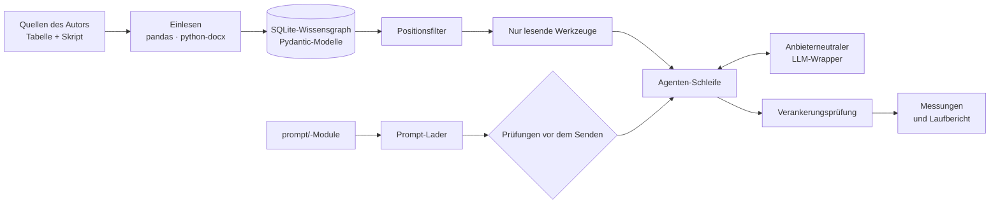

# Der Korridor — ein LLM-Agent mit positionsgebundenem Gedächtnis
English version: [Der Korridor — an LLM agent with position-bound memory](https://github.com/MelanieM2/der-korridor-info/blob/main/README.de.md)
> Technisches Rückgrat von *Der Korridor*, einem post-apokalyptischen Konzeptalbum mit einer begehbaren Begleitwebsite.
> Das Code-Repository [Der-Korridor](https://github.com/MelanieM2/Der-Korridor) ist privat, solange die Arbeit läuft; eine Veröffentlichung ist geplant.

## Die Idee

Das Album erzählt seine Geschichte als feste Abfolge kurzer innerer Monologe („Gedankenprotokolle“), die acht Figuren auf ihrem Weg durch eine unterirdische Anlage hinterlassen. In dieser Welt lebt die **Schwellenwächterin**: eine KI aus der Zeit vor der Krise, mit intakten analytischen Fähigkeiten, aber ohne Erinnerung an die Geschichte der Menschheit. Sie lernt nur, indem sie die Abfolge entlanggeht. An jeder Stelle weiß sie genau, was bis dorthin geschehen ist, und nichts darüber hinaus.

Dieses Projekt macht aus dieser Idee Software. Die Erzählung wird zu einem Wissensgraphen, und ein LLM-Agent liest ihn, analysiert ihn und belegt jede Aussage mit einem Text, den er tatsächlich gesehen hat. Die Schwellenwächterin hat eine Doppelrolle: Sie ist ein Analysewerkzeug für den Autor, während die Texte entstehen, und eine Figur innerhalb der Geschichte. Mit den Besucher\*innen der Website spricht sie nicht; dafür ist ein eigener Meta-Agent geplant.

## Designprinzipien

- **Bitte oder Garantie?** Jede Regel wird eingeordnet. Eine *Bitte* steht im Prompt und wird meistens befolgt; eine *Garantie* erzwingt der Code, und sie lässt sich nicht umgehen. Harte Grenzen werden nie dem Prompt überlassen, und was sich nicht erzwingen lässt, wird nach jeder Antwort gemessen.
- **Positionsgebundenes Wissen, im Code erzwungen.** Jeder Text hat eine Position (Zeile × 100 + Zelle, so bleibt die Tabellenstruktur ablesbar). Die Werkzeuge der Agentin sehen immer nur Knoten bis zu ihrer aktuellen Position. Ein *Kanarienvogel-Test* prüft das gegen ein echtes Modell: Erfundene Codewörter werden in ihre „Zukunft“ gelegt, der gesamte Verkehr zum Modell wird aufgezeichnet und durchsucht. Bisher kein Leck.
- **Verankerung.** Jede Aussage muss einen Knoten zitieren (`[node:<id>]`), den sie sehen darf. Antworten ohne Beleg werden verworfen und neu angefragt, danach als „kein Ergebnis“ gemeldet. Das LLM navigiert semantisch; eine deterministische Prüfung entscheidet, was zählt.
- **Jeder Wissenskanal braucht eine Grenze.** System-Prompt, Titel aus der Datenbank, Fragen, vom Code erzeugte Texte und Dateinamen erreichen alle das Modell. Bevor etwas gesendet wird, werden sie gegen eine gepflegte Liste von Wörtern geprüft, die ihr verraten würden, dass ihre Welt erfunden ist. Ein Aufzeichnungstest beweist, dass der Code nichts außerhalb der geprüften Texte sendet, und ein SHA-256-Prüfwert verbindet den gelesenen Prompt mit jedem Lauf.
- **Menschen entscheiden.** Die Agentin schlägt vor; nichts, was sie vorschlägt, wird automatisch gespeichert.

## Architektur

- **Kontext-Engineering:** Die Agentin bekommt ein kompaktes Inhaltsverzeichnis statt der Volltexte (etwa 12-mal kleinerer Kontext) und öffnet Texte über Werkzeuge; dabei wählt sie selbst zwischen schrittweisem und gebündeltem Lesen.
- **Der System-Prompt als geprüfte Software:** nach Funktion aufgeteilt (Basis, Methode, Aufgabe), je Aufgabe von einem Lader zusammengesetzt; jede Änderung ist in einem maschinenlesbaren Änderungsprotokoll mit Begründung festgehalten und wird gegen die Dateien abgeglichen.
- **Prüfungen auf dem Weg, den man nicht umgehen kann:** Vor einem echten Lauf prüft der Code Modell, Position, Prompt und Frage und fragt dann nach einer Bestätigung, die Modell, Prüfwert, Höchstlänge der Antwort und den Datenschutzstand zeigt. Jeder Fehler bricht ab.
- **Modellverwaltung:** Angefragt werden nur Modelle aus einer Positivliste geprüfter, allgemein verfügbarer Versionen (mit Status, Abschaltdatum, Preisen und Quelle). Vorabversionen und experimentelle Modelle sind ausgeschlossen; ein abgekündigtes Modell wird ab seinem Abschalttag abgelehnt.
- **Reproduzierbarer Neuaufbau aus sich ändernden Quellen:** Probelauf auf einer Kopie, Vergleich alt gegen neu, ausdrückliche Freigabekriterien. Widersprüche zwischen den Quellen werden dem Autor gemeldet, nie geraten.

## Tests

- Selbsttests mit synthetischen Daten und nachgebauten Clients im Antwortformat des Anbieters; kein API-Schlüssel nötig.
- Echte SDK-Klassen, getestet gegen einen nachgebauten Transport.
- Mutationstests: mehrere hundert absichtlich eingebaute Fehler in elf Testreihen, jeder von seiner eigenen, spezifischen Meldung erkannt.
- Kanarienvogel-Test und ausgewählte echte Läufe gegen ein laufendes Modell, weil manche Fehler nur dort sichtbar werden.
- Statische Typprüfung mit Pyright.

## Werkzeuge

| Bereich | Werkzeuge |
|---|---|
| Sprache und Pakete | Python ≥ 3.12, [uv](https://docs.astral.sh/uv/) mit exakt festgelegten Versionen und 7 Tagen Abstand zu neuen Veröffentlichungen |
| Daten | SQLite, Pydantic, pandas, python-docx |
| LLMs | Mistral (aktuelles Arbeitsmodell: Mistral Large 3), dazu Anthropic, Google Gemini und OpenAI über einen anbieterneutralen Wrapper mit Werkzeugaufrufen, Wiederholungen und Erkennung abgeschnittener Antworten |
| Qualität | pytest, pytest-mock, Pyright, eigene Mutationstest-Skripte |

## Stand

| Phase | Stand |
|---|---|
| Datenmodell und SQLite-Speicher | ✅ fertig |
| Einlesen der Erzählung (Tabelle + Skript → Graph) | ✅ fertig, reproduzierbarer Neuaufbau |
| Positionsfilter | ✅ fertig, gegen ein echtes Modell geprüft |
| Agentin Schwellenwächterin | ✅ läuft mit den echten Texten; als Nächstes: ihr stehender Auftrag an den sechs Stellen, an denen sie selbst spricht, und lesbare Analyseberichte für den Autor |
| Konzeptmaterial (zweite Ebene des Graphen) | 🟡 eingelesen; LLM-Extraktion vorbereitet |
| Erkennen von Verbindungen (die Agentin schlägt Verbindungen zwischen Texten vor, getrennt gespeichert) | ⚪ geplant für die endgültige Fassung der Texte |
| Suche mit Embeddings | ⚪ geplant |
| Meta-Agent für die Besucher\*innen der Website | ⚪ geplant |
| Einfache Oberfläche und Netzwerk-Visualisierung | ⚪ geplant |

## Credits & Urheberrecht

### Kernteam
- **Alexander Kesselring** — Texte, Musik und künstlerisches Konzept von *Der Korridor* (Geschichte und Figuren, einschließlich der *Schwellenwächterin*)
- **Rupert Pessl** — Fotografie
- **Melanie Maldonado** — Agentic-AI-Integration (der Code: [Der-Korridor](https://github.com/MelanieM2/Der-Korridor))

### Stimmen & Besetzung *(folgt in Kürze)*

Alle Rechte an den künstlerischen Werken – einschließlich Texten, Musik, Fotografien und Sprachaufnahmen – verbleiben als geistiges Eigentum bei den jeweiligen Urheber:innen und Mitwirkenden. Dieses Python-Projekt umfasst ausschließlich die technische Umsetzung. Das Code-Repository enthält nur den Quellcode und keine Texte oder Audiodateien des Albums. Die interaktive Erzählung wird separat auf einer externen Plattform veröffentlicht; der Link wird hier ergänzt, sobald sie verfügbar ist.

© 2026 **3000 Etagen tiefer** · Alexander Kesselring (Texte & Musik) · Rupert Pessl (Fotografie) · Melanie Maldonado (Code)

