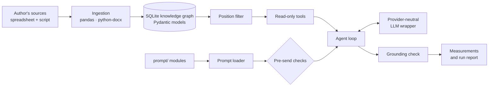

# Der Korridor — an LLM agent with position-bound memory
Deutsche Version: [Der Korridor — ein LLM-Agent mit positionsgebundenem Gedächtnis](https://github.com/MelanieM2/der-korridor-info/README.de.md)
> Technical backbone of *Der Korridor*, a post-apocalyptic concept album with a walkable companion website.
> The code repository [Der-Korridor](https://github.com/MelanieM2/Der-Korridor) is private while the work is in progress; a public release is planned.

## The idea

The album tells its story as a fixed sequence of short inner monologues ("thought protocols") left by eight characters moving through an underground facility. Within this world lives the **Schwellenwächterin** (*threshold guardian*): an AI from before the crisis, with intact analytical abilities but no memory of human history. She learns only by moving along the sequence. At any point she knows exactly what has happened up to there, and nothing beyond.

This project turns that idea into software. The narrative becomes a knowledge graph, and an LLM agent reads it, analyses it and grounds every statement in a text she has actually seen. She has a double role: an analysis tool for the author while the texts are being written, and a character inside the story. She does not talk to website visitors; a separate meta-agent is planned for that.

## Design principles

- **Request or guarantee?** Every rule is classified. A *request* lives in the prompt and is usually followed; a *guarantee* is enforced by code and cannot be bypassed. Hard boundaries are never left to the prompt, and what cannot be enforced is measured after every answer.
- **Position-bound knowledge, enforced in code.** Each text has a position (row × 100 + cell, which keeps the table structure readable). The agent's tools only ever see nodes up to her current position. A *canary test* checks this against a real model: invented code words are placed in her "future", all traffic to the model is recorded and searched. No leak so far.
- **Grounding.** Every statement must cite a node (`[node:<id>]`) she is allowed to see. Ungrounded answers are rejected and retried, then reported as "no result". The LLM navigates semantically; a deterministic check decides what counts.
- **Every knowledge channel needs a boundary.** System prompt, database titles, questions, code-generated texts and file names all reach the model. Before anything is sent, they are checked against a curated list of words that would reveal that her world is fictional. A recorder test proves the code sends nothing outside the checked texts, and a SHA-256 checksum binds the reviewed prompt to each run.
- **Humans decide.** The agent proposes; nothing she suggests is stored automatically.

## Architecture

- **Context engineering:** the agent receives a compact index instead of full texts (about 12× smaller context) and opens texts through tools, choosing between step-by-step and batched reading.
- **The system prompt as tested software:** split by function (base, method, task), assembled per task by a loader, with every change logged and justified in a machine-readable change log that is cross-checked against the files.
- **Checks in the path that cannot be skipped:** before a real run, the code verifies the model, the position, the prompt and the question, then asks for confirmation showing model, checksum, maximum answer length and the data-protection status. Any failure aborts.
- **Model governance:** only models on an allow-list of tested, generally available versions are called (with status, shutdown date, prices and source). Preview and experimental models are excluded; a deprecated model is refused from its shutdown date on.
- **Reproducible rebuilds from changing sources:** dry run on a copy, old-versus-new comparison, explicit release criteria. Contradictions between sources are reported to the author, never guessed.

## Testing

- Self-tests on synthetic data with fake clients in the provider's response format; no API key needed.
- Real SDK classes tested against a mock transport.
- Mutation testing: several hundred deliberately injected faults across eleven test suites, each one caught by its own specific message.
- Canary test and selected real runs against a live model, because some bugs only show up there.
- Static type checking with Pyright.

## Stack

| Area | Tools |
|---|---|
| Language and packaging | Python ≥ 3.12, [uv](https://docs.astral.sh/uv/) with exact pins and a 7-day delay on new releases |
| Data | SQLite, Pydantic, pandas, python-docx |
| LLMs | Mistral (current working model: Mistral Large 3), plus Anthropic, Google Gemini and OpenAI through one provider-neutral wrapper with tool calling, retries and truncation detection |
| Quality | pytest, pytest-mock, Pyright, custom mutation-test runners |

## Status

| Phase | Status |
|---|---|
| Data model and SQLite storage | ✅ done |
| Ingestion of the narrative (spreadsheet + script → graph) | ✅ done, reproducible rebuild |
| Position filter | ✅ done, verified against a real model |
| Threshold-guardian agent | ✅ running on the real texts; next: her standing task at the six points where she speaks herself, and readable analysis reports for the author |
| Concept material (second layer of the graph) | 🟡 ingested; LLM extraction prepared |
| Edge detection (agent proposes links between texts, stored separately) | ⚪ planned for the final version of the texts |
| Retrieval with embeddings | ⚪ planned |
| Meta-agent for website visitors | ⚪ planned |
| Simple interface and network visualisation | ⚪ planned |

## Credits and copyright

### Core Team
- **Alexander Kesselring** — texts, music, and artistic concept of *Der Korridor* (story and characters, including the *Schwellenwächterin*)
- **Rupert Pessl** — photography
- **Melanie Maldonado** — agentic AI integration (the code: [Der-Korridor](https://github.com/MelanieM2/Der-Korridor))

### Voice Cast *(to be announced)*

All rights to the artistic work—including texts, music, photographs, and voice recordings—remain the intellectual property of their respective creators and contributors. This Python project covers only the technical implementation. The code repository contains code only and none of the album's texts or audio files. The interactive narrative will be published separately on an external platform; the link will be added here once available.

© 2026 **3000 Etagen tiefer** · Alexander Kesselring (texts & music) · Rupert Pessl (photography) · Melanie Maldonado (code)

